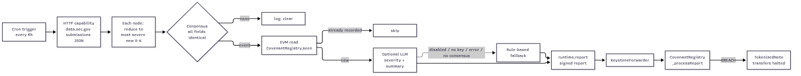
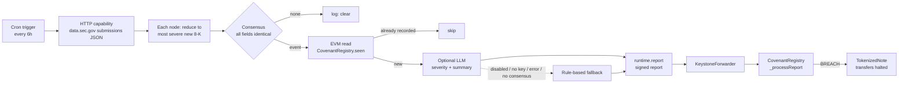

# CovenantWatch

**SEC EDGAR 8-K legal-event circuit breaker for tokenized notes, built on Chainlink CRE.**

## Problem

Tokenized debt (notes, bonds, private credit) keeps trading on-chain even after the issuer has told the SEC it
filed for bankruptcy, had its debt accelerated, got a delisting notice, or that its financials can't be relied on.
Those facts show up first in a public Form 8-K on EDGAR, often hours before anything moves on-chain. CovenantWatch
watches EDGAR from a decentralized oracle network and trips an on-chain "event of default" flag. A note contract
reads that flag and halts transfers.

| 8-K item | Meaning | Default class | Rule severity (1-5) |
|---|---|---|---|
| 1.03 | Bankruptcy or receivership | BREACH | 5 |
| 2.04 | Triggering events that accelerate a financial obligation | BREACH | 4 |
| 3.01 | Delisting / listing-rule failure | BREACH | 3 |
| 4.02 | Non-reliance on prior financial statements | BREACH | 3 |
| 1.01, 1.02, 2.03, 2.06, 3.03, 4.01, 5.01 | Material agreements, impairment, holder rights, auditor change, change of control | WATCH | — |

## Status (2026-10-15)

- **Simulated on CRE (staging target) against live SEC EDGAR**: `cre workflow simulate` fetched real
  `data.sec.gov` submissions and ran the full handler. Output: [docs/simulate-2026-10-15.txt](docs/simulate-2026-10-15.txt).
- **Local contract demo**: anvil + forge deploy of CovenantRegistry + TokenizedNote, then a report built from a
  recorded real 8-K (Petros Pharmaceuticals, CIK 1815903, accession 0001104659-26-112399, Items 1.03 + 2.04,
  filed 2026-09-30) is delivered through `onReport`, and note transfers halt. Output:
  [docs/local-demo-2026-10-15.txt](docs/local-demo-2026-10-15.txt).
- **Deployment pending**: deploy access to a Chainlink DON has been requested (`cre account access`) and is awaiting
  approval. Registry addresses in `config.*.json` are placeholders until then.

## Architecture





- `my-workflow/edgar.ts` — pure, unit-tested EDGAR parsing: 8-K item masks, severity, window selection, URLs.
- `my-workflow/workflow.ts` — CRE handler: cron → HTTP (with SEC-required User-Agent) → `ConsensusAggregationByFields`
  → registry `seen()` read (idempotent across ticks) → optional LLM assessment → `writeReport`.
- `my-workflow/assess.ts` — LLM request/response handling and the deterministic rule-based fallback.

## Contracts (`contracts/evm/src`)

- **CovenantRegistry.sol** (`ReceiverTemplate`, only the CRE forwarder can deliver reports). Decodes
  `(uint64 cik, bytes32 accessionHash, uint32 filingDate, uint32 itemsMask, uint8 severity, string accession)`,
  dedupes by accession hash, and stores `lastEvent`/`eventCount`. It emits `LegalEventRecorded`, and for BREACH
  severity it also emits `BreachFlagged` and sets `isBreached(cik)`. The owner can `cure(cik, note)`, for example
  after a waiver.
- **TokenizedNote.sol**: a minimal note token bound to one issuer CIK. `transfer` reverts while
  `registry.isBreached(cik)` is true.

## LLM step + fallback

Turn this on with `"llm": { "enabled": true, ... }` in `config.*.json`. It is off by default. It runs only for
qualifying items 1.03 / 2.04 / 3.01 / 4.02. The workflow POSTs an OpenAI-compatible chat completion
(`temperature: 0`, JSON output) through the CRE HTTP capability. The nodes must agree exactly on
`{severity, summary}`.

- The API key comes **only** from CRE secrets (`LLM_API_KEY`, mapped in `secrets.yaml` to env var
  `LLM_API_KEY_VAR`). It is never placed in config or committed, and `.env` is gitignored.
- The workflow falls back to a deterministic **rule-based** result in these cases: the step is disabled, the secret
  is missing, there is an HTTP or parse error, or the nodes don't reach consensus. The rule-based result uses a fixed
  severity per item code (table above) and a templated summary.
- The assessment is **advisory**. It is logged and is not part of the on-chain report. A model therefore can never
  flag or un-flag a breach by itself. The on-chain severity always comes from the rule-based classification.

Note: LLM outputs are often not byte-identical across nodes, even at temperature 0. In that case consensus fails
and the fallback is used. For production, use confidential HTTP / Vault DON secrets.

## Build / test / simulate

```bash
cd my-workflow && bun install && bun test        # 21 tests (edgar, workflow, LLM/fallback)
cd ../contracts/evm && forge test                # 7 tests
cre workflow simulate my-workflow --target staging-settings   # see docs/simulate-2026-10-15.txt
# with LLM: set LLM_API_KEY_VAR in .env (gitignored) and "llm.enabled": true
```

## Run the demo

```bash
# 1. CRE simulation against live EDGAR (needs `cre login`)
cre workflow simulate my-workflow --target staging-settings

# 2. Local contract demo (needs Foundry + bun; starts and stops its own anvil on :8545)
./scripts/local-demo.sh
```

`scripts/local-demo.sh` deploys both contracts, makes a normal transfer, then encodes the recorded EDGAR fixture
`fixtures/edgar-petros-CIK0001815903.json` with the workflow's own `eightKs` / `pickEvent` /
`encodeLegalEventReport` code (`scripts/encode-fixture.ts`). An anvil account plays the KeystoneForwarder and calls
`onReport(metadata, report)`. The script then shows `isBreached = true`, that a transfer reverts with
`TransfersHalted(1815903)`, that a non-forwarder caller is rejected, that a duplicate report is ignored, and that the
trustee's `cure()` resumes transfers.

## Limitations

- **Not deployed yet.** The workflow has been simulated, not deployed, so the simulation's EVM write did not
  reach a live registry. The on-chain path was shown on a local anvil chain with an account standing in for the
  KeystoneForwarder. Deployment is pending Chainlink deploy-access approval.
- The workflow uses EDGAR `filings.recent` only and only looks at item codes. It does not read the filing text, so
  it can't tell whether an 8-K actually concerns the noted debt.
- The lookback window and the per-issuer "most severe" reduction mean at most one report per issuer per tick.
- SEC fair-access rules apply (≤10 req/s, descriptive User-Agent).
- `cure()` is owner-controlled (trusted trustee), and the contracts are unaudited demo code.
